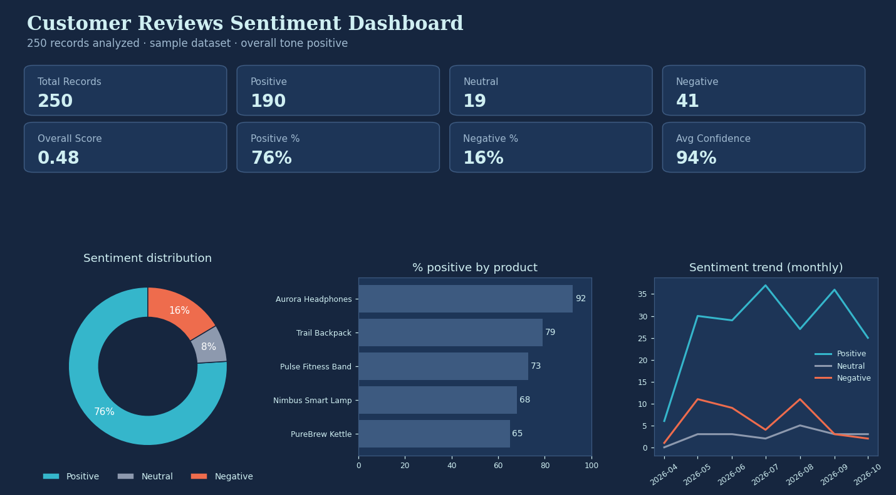

# 📊 AI-Powered Customer Sentiment Analysis & Insights Dashboard

**Week 3 – Sentiment Analysis & Data Insights** · Theme: *AI for Data Analysis & Insights*

An interactive web app that reads customer feedback (reviews, comments, support tickets, survey answers), classifies each piece of text as **Positive, Neutral or Negative**, and turns the results into KPIs, charts, plain-English insights and a downloadable report. Upload new data and everything recalculates immediately.

**Live app:** _add your Streamlit link here_ · **Author:** _add your name here_



> The images in this README were generated from the app's own analysis of the built-in sample dataset (250 synthetic reviews), so the numbers shown are real outputs of the code.

---

## Table of contents
1. [The problem](#the-problem)
2. [What the app does](#what-the-app-does)
3. [How it works](#how-it-works)
4. [The sentiment model](#the-sentiment-model)
5. [Your data](#your-data)
6. [Using the app](#using-the-app)
7. [Test datasets and results](#test-datasets-and-results)
8. [Project structure](#project-structure)
9. [Run locally](#run-locally)
10. [Deploy on Streamlit Community Cloud](#deploy-on-streamlit-community-cloud)
11. [Limitations](#limitations)
12. [Future improvements](#future-improvements)
13. [Tech stack and skills demonstrated](#tech-stack-and-skills-demonstrated)

---

## The problem
Companies collect thousands of comments, but nobody can read them all, and text cannot be put straight into a chart. This project converts unstructured text into numbers, patterns and recommendations so a manager can see **how customers feel, why, and what to do next**.

## What the app does
- **Analyzes new data in real time.** Upload a CSV, type or paste comments (one per line), or load the sample data. KPIs, charts, tables and insights refresh without a page reload.
- **Replaces the old data on every upload**, so results always reflect only the newest dataset. The dashboard title is built from the uploaded file's name.
- **Checks data quality first:** missing text, very short text, duplicates, invalid dates and invalid ratings. Excluded rows are listed, never silently dropped.
- **Eight KPIs:** total records, positive, neutral and negative counts, overall score, positive %, negative %, average confidence.
- **Interactive charts:** sentiment distribution, trend over time (daily, weekly, monthly), score histogram, % positive by product or category, rating vs predicted sentiment, and top keywords.
- **Global filters:** sentiment, date range, category, product, location, department, channel, customer type, rating and minimum confidence. Filters appear only when your file has the matching column.
- **AI-assisted insights:** overall picture, positive drivers, negative drivers, emerging trends and recommended actions, written from the loaded data (nothing is hardcoded).
- **Data Explorer:** search, sort, page through records and click a row to see its text, score, confidence, tone and keywords.
- **Reports and exports:** an 11-section insights report (HTML or Markdown), plus CSV and Excel exports of the filtered results.
- **Honest model information:** accuracy, precision, recall and F1 are shown **only** when the file contains labelled sentiment values.

## How it works


| Stage | What happens | Code |
|---|---|---|
| Input | CSV (comma, semicolon, tab or pipe separated; UTF-8 or Windows encoding), typed text or sample data | `read_upload()` |
| Validation | Missing, short and duplicate rows are excluded and listed; bad dates and ratings are flagged | `analyze()` |
| Preprocessing | Lowercase, remove URLs and punctuation, tokenise, remove stop words. The original text is always kept next to the processed text | `tokenize()`, `keywords()` |
| Sentiment model | Each record gets a score, label and confidence | `predict()` |
| Analytics | KPIs, trends, segments, keyword counts | `segment_table()`, `keyword_stats()` |
| Insights and reports | Rule-based sentences and the report are generated from the statistics | `insights()`, `report_markdown()` |

## The sentiment model
The default model is a **lexicon-and-rules classifier** in the style of VADER. It is fast, needs no training data and every score can be explained.


1. A hand-built dictionary gives each sentiment word a weight (for example *excellent* is strongly positive and *terrible* strongly negative).
2. **Intensifiers** such as *very* and *extremely* boost the weight of the next words; *slightly* and *somewhat* reduce it.
3. **Negation** (*not, no, never, hardly, without* or words ending in *n't*) within the previous three words flips the weight and reduces it by 25%.
4. Each exclamation mark adds 10% (up to three).
5. The total is normalised to a score between **-1 and +1**.
6. Labels: **Positive** at +0.15 or above, **Negative** at -0.15 or below, otherwise **Neutral**.
7. **Confidence** is a heuristic that rises as the score moves away from the neutral zone (and is highest for scores close to zero when the label is Neutral). It is **not** a measured accuracy.

The model is one function, `predict()` in `sentiment.py`. To use Naive Bayes, TF-IDF with logistic regression, DistilBERT or an API-based model, replace that function with one that returns the same fields.

### Keywords in the sample data


Keywords are counted per review, so a phrase like "not good" still contributes the word *good* to the keyword list even though the model scores the whole sentence as negative. Read keyword lists as "words that appear in positive or negative reviews", not as sentiment scores on their own.

## Your data
You need a CSV with a header row and at least one text column. Everything else is optional but unlocks more features.

| Column header | What it enables |
|---|---|
| `review`, `review_text`, `comment`, `feedback`, `message`, `text`, `description` | Detected as the text to analyze (if several are found, you choose) |
| `date`, `created_at`, `timestamp` | Trend chart, date filter, improving/declining indicator |
| `rating`, `stars` (1 to 5) | Rating vs sentiment chart and rating filter |
| `category`, `product` | Sentiment by segment, filters and insights naming the best and worst performers |
| `location` (or `city`, `country`), `department`, `channel`, `customer_type` | Extra filters |
| `sentiment` or `label` (positive / neutral / negative) | Ground truth, used to calculate accuracy, precision, recall and F1 |

Limits: `.csv`, `.tsv` or `.txt` files up to 25 MB, English text. Excel files should be saved as CSV first.

## Using the app
| Section | What you can do |
|---|---|
| **Dashboard** | Title, record count, overall tone, eight KPI cards and the sentiment donut |
| **Data Upload** | Upload a CSV, paste text, load the demo data, download sample files, review the Data Quality Summary and excluded rows |
| **Sentiment Analysis** | All charts and keyword lists |
| **Insights** | Written findings: overall, drivers, trends and recommended actions |
| **Data Explorer** | Search and sort records, open a record's details, export CSV or Excel |
| **Reports** | Generate the 11-section report and download it |
| **Model Information** | Model details, metrics (only with labelled data) and a plain-language explanation |
| **Project Overview** | Project description, technologies and competencies |

The sidebar holds the navigation and the global filters, which apply to every page.

## Test datasets and results
The `data/` folder contains four synthetic datasets so you can test different topics and column layouts.

| File | Topic | Rows |
|---|---|---|
| `sample-reviews-250.csv` | Product reviews (loaded on start) | 250 |
| `dataset-restaurant-delivery-reviews.csv` | Food delivery | 120 |
| `dataset-telecom-support-tickets.csv` | Customer support | 120 |
| `dataset-banking-app-reviews.csv` | Mobile banking and investing | 120 |

The three `dataset-` files include a `sentiment` column holding the label each row was written to have. Running the model against those labels gives:

| Dataset | Labelled records | Accuracy | Macro F1 |
|---|---|---|---|
| Restaurant delivery reviews | 120 | 75% | 67% |
| Telecom support tickets | 120 | 91% | 88% |
| Banking app reviews | 120 | 88% | 87% |

**Read these figures carefully.** The labels were created together with the text from templates, so they are a useful test of the pipeline but **not a benchmark** of real-world accuracy. Mixed reviews such as "great product but slow delivery" are labelled neutral, which accounts for many of the disagreements. The sample file has no labels, so the app reports that metrics are unavailable for it.

## Project structure
```
├── app.py                 Streamlit interface: navigation, filters, charts, exports
├── sentiment.py           Preprocessing, model, data quality, analytics, insights, report
├── requirements.txt       Python dependencies
├── .streamlit/
│   └── config.toml        Dark blue theme and upload size limit
├── data/                  Sample and test datasets (CSV)
└── docs/                  Images used in this README
```
`sentiment.py` contains no Streamlit code, so the analysis can be tested or reused on its own. If `data/sample-reviews-250.csv` is missing, the app generates the same sample itself.

## Run locally
```bash
pip install -r requirements.txt
streamlit run app.py
```
Then open the address shown in the terminal (usually http://localhost:8501).

## Deploy on Streamlit Community Cloud
1. Upload this whole folder to a GitHub repository. `app.py` must be at the top level.
2. Go to <https://share.streamlit.io> and sign in with GitHub.
3. Click **Create app**, choose the repository and branch, and set **Main file path** to `app.py`.
4. Click **Deploy**. The first build installs `requirements.txt` and takes a minute or two.
5. Paste the app's link at the top of this README.

## Limitations
- The lexicon model reads words, not meaning. **Sarcasm** ("great, another delayed delivery") will likely be scored positive.
- The dictionary is small and general, so specialist vocabulary can be missed.
- English only.
- Confidence is a heuristic, not a probability.
- Insights summarise patterns in the data; they do not explain causes.
- Uploaded data lives only in the browser session and is not stored; refreshing the page returns to the sample data.
- The Streamlit version has no word cloud, no click-to-filter on the donut chart and no direct PDF export (the HTML report can be printed to PDF).

## Future improvements
- Train TF-IDF with logistic regression or Naive Bayes on labelled data and compare it with the lexicon baseline.
- Add a transformer model (DistilBERT or a Hugging Face sentiment model) with API keys stored in environment variables.
- Aspect-based sentiment (delivery, price, support) and emotion detection.
- Multi-language support and sarcasm handling.
- Editable industry dictionaries and saved report history.

## Tech stack and skills demonstrated
**Python · Pandas · Plotly · Streamlit · NLP preprocessing · Rule-based sentiment classification · Data validation · Data visualization · Insight generation**

Skills: data interpretation, analytical thinking, text classification, basic machine learning concepts (evaluation metrics against labelled data), AI-assisted insights, business intelligence and individual project ownership.
